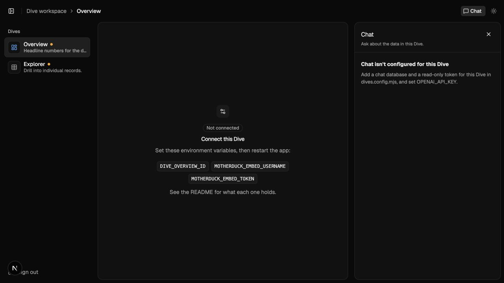
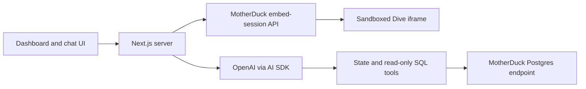

# MotherDuck Dive + AI Chat Starter

**Embed a MotherDuck dashboard. Ask questions about the data behind it.**

A small Next.js starter for embedded analytics with a streaming AI SQL assistant. It includes a configurable Dive sidebar, light and dark themes, mobile chat, SQL receipts, and server-side credential handling. Bring your own saved Dive and read-only data access.

<details>
<summary>First-run preview</summary>



The starter before connecting a saved Dive or configuring chat. No customer data is included.

</details>

## Run it locally

Requires Node.js 24–26 and npm. You can inspect the interface without any credentials.

```sh
git clone https://github.com/leonardovida/motherduck-dive-ai-chat-starter.git
cd motherduck-dive-ai-chat-starter
npm ci
npm run dev
```

Open **http://localhost:3000** and sign in with **`duckdemo`**. This password works only in development when `DEMO_PASSWORD` is unset. You should see the Overview and Explorer placeholders with the exact configuration they need.

## Connect your first Dive

1. Save [`dives/starter.tsx`](dives/starter.tsx) as a Dive in MotherDuck, or use an existing Dive. The included starter runs a date query and exposes a sample selection through `useDiveState`; it needs no data share.
2. Create a **read-only service account** for embedding. If your Dive reads data, grant it access only to the required share or database. Your MotherDuck plan must support embedded Dives.
3. Copy the environment template and fill in these three values:

   ```sh
   cp .env.example .env.local
   ```

   ```dotenv
   MOTHERDUCK_EMBED_TOKEN=your-server-side-embed-token
   MOTHERDUCK_EMBED_USERNAME=your-read-only-service-account
   DIVE_OVERVIEW_ID=your-saved-dive-uuid
   ```

   The embed token must be authorized to create embed sessions for your organization. It stays on the server; the embedded Dive runs as the named service account.
4. Restart `npm run dev`. Open **Overview**. The included starter should display a date and three selectable options.

For a Dive that declares `REQUIRED_DATABASES`, add matching resources to its entry in [`dives.config.mjs`](dives.config.mjs):

```js
resources: [{ urlEnv: 'DIVE_OVERVIEW_SHARE_URL', alias: 'sales' }],
```

Set `DIVE_OVERVIEW_SHARE_URL` in your runtime environment. `sales` must match the catalog alias used by the Dive's SQL. The default Overview entry intentionally has no resources, matching the included starter.

## Enable AI chat

Add the following server-side values and restart the app:

```dotenv
OPENAI_API_KEY=your-openai-key
MOTHERDUCK_CHAT_TOKEN=your-read-only-data-token
DIVE_OVERVIEW_CHAT_DATABASE=your-database-or-attached-share-alias
```

Open **Chat** after the Dive loads. The assistant can inspect the current Dive state, discover tables, describe columns, and run bounded read-only queries. It streams its answer and shows the SQL used to support it.

The chat queries your configured database; it does not scrape chart pixels or execute SQL through the iframe. Filters reach chat when your Dive stores them with `useDiveState`. The data-free starter can demonstrate selected state, but meaningful data questions require a populated chat database.

### Models

The server owns the model catalog in [`lib/chat-models.mjs`](lib/chat-models.mjs). The client sends only an enabled tier key.

| Tier | Default model | Use |
| --- | --- | --- |
| Luna | `gpt-6-luna` | Fast everyday questions |
| Sol | `gpt-6.1-sol` | Multi-step analysis |
| Astra | `gpt-6-astra` | More involved questions |

`OPENAI_MODEL` selects the default model/tier. `OPENAI_CHAT_MODELS=luna,sol` restricts the picker. Check model access in your own OpenAI project. Follow-up suggestions are off by default to avoid an extra model request; set `CHAT_FOLLOW_UPS=true` to enable them with a 2.5-second completion budget.

## Add another dashboard

Copy an entry in `dives.config.mjs`, give it a unique `key`, and point its env names at your Dive and chat database. Remove Explorer if you only need one dashboard.

```js
{
  key: 'sales',
  title: 'Sales',
  description: 'Revenue by month and region.',
  icon: 'chart-line',
  diveIdEnv: 'DIVE_SALES_ID',
  resources: [{ urlEnv: 'DIVE_SALES_SHARE_URL', alias: 'sales' }],
  chat: {
    tokenEnv: 'MOTHERDUCK_CHAT_TOKEN',
    databaseEnv: 'DIVE_SALES_CHAT_DATABASE',
  },
  starters: ['Which region grew fastest?'],
}
```

No account identifiers, tokens, or share URLs belong in the source. Each Dive can use its own read-only chat token by naming another `tokenEnv`.

## How it works



Embed sessions are sent in the iframe URL **fragment**, not its query string. The host checks message origin and frame identity before accepting state, exports, or navigation requests. The AI and database tokens stay server-side.

One chat answer reuses one lazy Postgres connection across tool calls and closes it on completion or cancellation. Only bounded text history is sent on the next turn; large tool results remain in the UI. See [architecture and boundaries](docs/architecture.md).

## Deploy

Import this repository into a Next.js-compatible host. The application is at the **repository root**. No monorepo root override is required.

Set the Dive/chat values above, plus:

```dotenv
DEMO_PASSWORD=your-own-strong-password
SESSION_SECRET=a-random-value-of-at-least-32-characters
```

Generate a session secret with `openssl rand -hex 32`. Production sign-in refuses to work without both values. Set `MOTHERDUCK_PG_HOST` for your database's region; its default is `pg.us-east-1-aws.motherduck.com`.

**GitHub repository secrets do not configure your deployed app.** They are available only to workflows. Add runtime secrets separately through your deployment platform or secret manager. Nothing under `.env.local` is committed.

The included password gate and in-process rate limits are suitable for a shared demo. Before serving multiple customers, use your application's authentication, shared rate limiting, and server-owned tenant-to-Dive/data mappings. A browser filter or chat prompt is never an access-control boundary. The read-only database identity and its grants enforce data access; the SQL guard is a conservative additional layer.

## Verify and troubleshoot

```sh
npm test
npm run build
```

Tests require no live credentials and cover authentication, configuration, embed sessions, SQL guards, request-size bounds, bounded chat history, reader lifecycle, exports, and streamed tool calls against a fake OpenAI endpoint.

`npm run smoke:openai` performs one minimal real OpenAI request when a key is injected. CI runs tests and a build without secrets. The optional manual **Checks** workflow can run the live smoke check using the repository's `OPENAI_API_KEY` secret; it is disabled by default.

| Symptom | Check |
| --- | --- |
| Overview says “Not connected” | Fill the missing env names shown in the UI, then restart. The included starter does not need a share. |
| Embed creation fails | Verify the saved Dive ID, embedding entitlement, embed-token permission, service account, and data grants. |
| Chat is not configured | Set the OpenAI key, chat token, and database env name for the selected Dive. |
| Chat cannot find a table | Verify the read-only token's grants and the database/share alias; tables are scoped to that database. |
| Production sign-in is unavailable | Set a non-empty `DEMO_PASSWORD` and a `SESSION_SECRET` of at least 32 characters. |
| SQL is rejected | Use one supported read-only query. Writes, file readers, external locations, and dynamic SQL are intentionally refused. |

## Project map

- `dives.config.mjs`: dashboard configuration and suggested questions.
- `dives/starter.tsx`: a data-free Dive to verify embedding and state.
- `src/App.jsx`: authentication UI, sidebar, iframe lifecycle, and layout.
- `src/components/chat-panel.jsx`: streaming chat and SQL receipts.
- `app/api/chat/route.js`: AI SDK streaming and server-owned tools.
- `api/`: small testable auth, embed-session, and Dive-list handlers.
- `lib/`: session handling, SQL guard, bounded request parsing, data tools, and model catalog.
- `test/`: credential-free regression tests.
