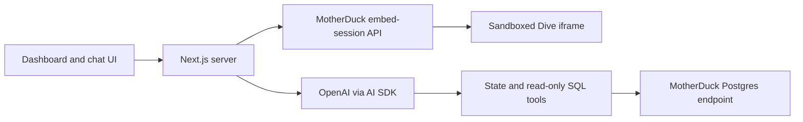

# MotherDuck Dive + AI Chat Starter

**Put a live MotherDuck dashboard in your own app, and let people ask questions about the data behind it.**

[](https://github.com/leonardovida/motherduck-dive-ai-chat-starter/actions/workflows/checks.yml)
[](https://github.com/leonardovida/motherduck-dive-ai-chat-starter/releases)
[](LICENSE)


<sub>First run, before anything is connected. Each area lists exactly which settings it needs.</sub>

## What you get

- **Your dashboard, embedded.** Any saved [MotherDuck Dive](https://motherduck.com/docs/key-tasks/dives/) appears inside the app, in light or dark mode, on desktop and phone.
- **An AI analyst next to it.** Viewers ask questions in plain English. The assistant looks up the tables, runs read-only SQL and streams back an answer.
- **Answers you can check.** Every answer has a "SQL receipt" showing the exact queries behind it.
- **Context-aware follow-ups.** When a viewer picks a filter in the dashboard, the assistant knows about it. "What about this region?" just works.
- **OpenAI or Anthropic, sized to the question.** On **Auto**, simple questions go to a small, cheap model and hard ones to a larger one. The app moves up a tier on its own if the small model struggles.
- **People, access and an admin portal (optional).** Give each person their own login, choose which dashboards and whether AI chat they get, connect your single sign-on, and read past conversations.
- **Safe by default.** Keys stay on the server. Chat uses a read-only identity. A password or per-person accounts protect the app.

It is a small Next.js app. Use it as a demo, an internal tool, or the starting point for embedded analytics in your product.

## Get started

Pick the path that suits you. All three end in the same place.

| | Path | Good for | Time |
| --- | --- | --- | --- |
| 🤖 | [Let a coding agent set it up](#option-1-let-a-coding-agent-set-it-up) | Anyone with Claude Code, Codex, Cursor or a similar agent | About 15 minutes |
| 💻 | [Try it on your computer](#option-2-try-it-on-your-computer) | Seeing the interface before connecting anything | 5 minutes |
| ☁️ | [Deploy to Vercel](#option-3-deploy-to-vercel) | Sharing a link with your team or customers | 10 minutes once you have the [things you need](#what-you-need) |

### Option 1: Let a coding agent set it up

Open this repository in your coding agent and paste:

> Set up this starter for my MotherDuck Dive and AI chat. Follow AGENTS.md. Discover and configure the resources using my authorized connections. Tell me which secrets to add to my runtime secret manager, then verify the complete browser flow. Keep it local and private.

The agent finds your Dive, service account and database, configures the app, and runs the checks. It asks you for three secrets: an AI key (`OPENAI_API_KEY` or `ANTHROPIC_API_KEY`), `MOTHERDUCK_EMBED_TOKEN` and a read-only `MOTHERDUCK_CHAT_TOKEN`. It tells you where to store them, never in the chat.

If you already know which Dive you want, name it in the prompt. For the full handoff, see the [agent setup guide](docs/agent-setup.md). Agents start from [AGENTS.md](AGENTS.md).

### Option 2: Try it on your computer

You need [Node.js](https://nodejs.org/) 24, 25 or 26. No accounts or keys are required to look around.

```sh
git clone https://github.com/leonardovida/motherduck-dive-ai-chat-starter.git
cd motherduck-dive-ai-chat-starter
npm ci
npm run dev
```

Open **http://localhost:3000** and sign in with the password **`duckdemo`**. This password only works on your computer. The app shows placeholders that say what each part needs. Next, [connect your Dive](#connect-your-dive) and [turn on chat](#turn-on-ai-chat).

### Option 3: Deploy to Vercel

Have the [things you need](#what-you-need) ready, then click:

[](https://vercel.com/new/clone?repository-url=https%3A%2F%2Fgithub.com%2Fleonardovida%2Fmotherduck-dive-ai-chat-starter&project-name=motherduck-dive-ai-chat&repository-name=motherduck-dive-ai-chat&env=DEMO_PASSWORD,SESSION_SECRET,MOTHERDUCK_EMBED_TOKEN,MOTHERDUCK_EMBED_USERNAME,DIVE_OVERVIEW_ID,OPENAI_API_KEY,MOTHERDUCK_CHAT_TOKEN,DIVE_OVERVIEW_CHAT_DATABASE&envDescription=A%20sign-in%20password%20and%20session%20secret%2C%20your%20MotherDuck%20embed%20and%20read-only%20chat%20tokens%2C%20the%20Dive%20to%20show%2C%20and%20an%20OpenAI%20API%20key.&envLink=https%3A%2F%2Fgithub.com%2Fleonardovida%2Fmotherduck-dive-ai-chat-starter%2Fblob%2FHEAD%2Fdocs%2Fconfiguration.md%23settings)

Vercel copies the repository to your GitHub account and asks for eight settings. To use Anthropic instead of OpenAI, enter a placeholder for `OPENAI_API_KEY`. Then, under **Settings → Environment Variables**, delete it, add `ANTHROPIC_API_KEY` and redeploy. To turn on accounts, add `MOTHERDUCK_APP_TOKEN` there and follow [docs/accounts.md](docs/accounts.md). Each one is explained in the [settings reference](docs/configuration.md#settings). For `SESSION_SECRET`, paste the output of `openssl rand -hex 32`. For `DEMO_PASSWORD`, choose a strong password and share it only with your viewers.

You can deploy to any host that runs Next.js. The app lives at the repository root. Production needs HTTPS. On hosts other than Vercel, also set `AUTH_TRUSTED_IP_HEADER` (see [settings](docs/configuration.md#sign-in)).

## What you need

| | Item | Why |
| --- | --- | --- |
| ☐ | A **MotherDuck account** on a plan that supports embedded Dives | To show the dashboard inside your app |
| ☐ | A **saved Dive** | The dashboard to show. No Dive yet? Save the included [`dives/starter.tsx`](dives/starter.tsx). |
| ☐ | A **read-only service account** with access to the Dive's data | The embedded Dive and the chat run as this account, so viewers only see what it can read |
| ☐ | An **embed token** | Lets the server open short-lived dashboard sessions |
| ☐ | A **read-only chat token** and the database chat should query | Lets the assistant run SQL, and nothing more |
| ☐ | An **OpenAI or Anthropic API key**, or both | Powers the assistant |
| ☐ | *Optional:* a **MotherDuck token for an app database** | Turns on per-person accounts, the admin portal, SSO and saved conversations. See [Accounts](#add-people-an-admin-portal-and-single-sign-on). |

<details>
<summary>Words you'll see</summary>

- **Dive**: an interactive dashboard saved in MotherDuck, written as a small React component.
- **Service account**: a MotherDuck user for software rather than a person. Here it should be read-only.
- **Embed session**: a short-lived pass that lets the browser show one Dive as the service account. The server creates it, so your token never reaches the browser.
- **Share**: a read-only copy of a database that a Dive or another account can attach.
- **Environment variable / setting**: a named value, such as `OPENAI_API_KEY`, that the app reads at startup. Secrets are stored this way, outside the code.
- **Secret manager**: where secrets live safely, for example 1Password, your host's environment settings, or a local `.env.local` file that Git ignores.

</details>

## Connect your Dive

1. **Save a Dive** in MotherDuck, or use one you already have. The included [`dives/starter.tsx`](dives/starter.tsx) needs no data and is a good first test.
2. **Create a read-only service account.** If your Dive reads data, give it access to that data only.
3. **Add the settings.** For local use, copy the template and fill in three values:

   ```sh
   cp .env.example .env.local
   ```

   ```dotenv
   MOTHERDUCK_EMBED_TOKEN=your-embed-token
   MOTHERDUCK_EMBED_USERNAME=your-read-only-service-account
   DIVE_OVERVIEW_ID=your-saved-dive-id
   ```

4. **Check the connection**, then restart the app:

   ```sh
   npm run check:setup -- --live
   npm run dev
   ```

Open **Overview**. With the starter Dive, you see today's date and three buttons.

If your Dive reads a share (it lists one in `REQUIRED_DATABASES`), add the share as a resource. See [Add another dashboard](docs/configuration.md#add-another-dashboard).

## Turn on AI chat

Add three more settings and restart:

```dotenv
OPENAI_API_KEY=your-openai-key          # or ANTHROPIC_API_KEY=your-anthropic-key, or both
MOTHERDUCK_CHAT_TOKEN=your-read-only-token
DIVE_OVERVIEW_CHAT_DATABASE=the-database-chat-may-query
```

Run `npm run check:setup -- --live` again. It checks the database connection and model access without spending tokens on an answer. Then open **Chat** and try one of the suggested questions. Expand the SQL receipt under the answer to see how it was worked out.

The model picker starts on **Auto**, which sends each question to the cheapest model likely to answer it well. Auto answers are labelled with the model used; hover over the label to see why. To pick providers and models, see [Models and routing](docs/model-routing.md).

Chat queries your database directly. It does not read the chart pixels. To answer questions about a viewer's selections, the Dive needs to store them with `useDiveState`. See [Make chat aware of what viewers select](docs/configuration.md#make-chat-aware-of-what-viewers-select).

## Add people, an admin portal and single sign-on

By default everyone shares one password. To give each person their own login:

1. Add `MOTHERDUCK_APP_TOKEN`, a token that can write to one MotherDuck database the app owns (not your analytics data).
2. Run `npm run db:migrate` to create the tables.
3. Run `npm run admin:create -- --username=you` to create the first administrator.

Sign in, then open **Admin** in the sidebar. There you can:

- **Add people** with usernames and passwords, reset passwords, and disable or remove accounts.
- **Choose access:** all dashboards or a chosen few, with or without AI chat.
- **Read conversations:** every question, answer and SQL query, with the model that answered.

To let people sign in with **Okta, Microsoft Entra ID, Google Workspace** or any OpenID Connect provider, add the provider's client ID and secret. The full guide, including privacy and retention settings, is in [docs/accounts.md](docs/accounts.md).

## Make it yours

- **Change the title:** set `APP_TITLE`.
- **Add more dashboards:** add entries to [`dives.config.mjs`](dives.config.mjs). See [Add another dashboard](docs/configuration.md#add-another-dashboard).
- **Choose the AI models and providers:** see [Models and routing](docs/model-routing.md).
- **Change the suggested questions:** edit `starters` for each dashboard in [`dives.config.mjs`](dives.config.mjs).

## Keeping your data safe

- What viewers and chat can see depends on the **read-only MotherDuck identities** you configure. Grant them only the data they need.
- **Tokens and keys stay on the server.** The browser receives only a short-lived dashboard session.
- **Chat can only read.** The SQL guard refuses writes, file access and external locations, and the read-only token enforces the same limits in the database.
- **Sign-in fits the audience.** A shared password suits demos. [Accounts](docs/accounts.md) give each person their own login, their own access and optional SSO. A browser filter or a chat prompt is never a security boundary.
- **Saved conversations are announced.** In accounts mode, the chat panel tells people that administrators can read conversations. Turn saving off or set a retention period in [settings](docs/accounts.md#saved-conversations-and-privacy).

[docs/architecture.md](docs/architecture.md) covers the full design.

## Troubleshooting

| What you see | What to do |
| --- | --- |
| The dashboard says **"Not connected"** | Add the settings it lists, then restart the app. |
| The dashboard fails to load | Run `npm run check:setup -- --live`. "Not found" usually means a wrong Dive ID or service-account username. "Unauthorized" or "forbidden" means the token, the plan's embedding access or the service account's access needs checking. |
| Chat says it **isn't configured** | Add `OPENAI_API_KEY` or `ANTHROPIC_API_KEY`, `MOTHERDUCK_CHAT_TOKEN` and the dashboard's chat database setting. |
| Chat says it **isn't included in your access** | An administrator can turn on chat for you under **Admin → People → Edit access**. |
| **Admin** is missing from the sidebar | Only administrators see it, and only in accounts mode. Run `npm run admin:create -- --username=<you>` to make yourself an administrator. |
| Single sign-on says it **did not complete** | Check the redirect URI registered with your provider, and whether the person has an account or an allowed email domain. See [Single sign-on](docs/accounts.md#single-sign-on). |
| Chat **can't find a table** | Check that the read-only chat token can read that database, and that the database name in the settings is right. |
| **Can't sign in** after deploying | Set `DEMO_PASSWORD` and a `SESSION_SECRET` of at least 32 characters. On hosts other than Vercel, also set `AUTH_TRUSTED_IP_HEADER`. |
| Chat **refuses a query** | This is intended. Chat runs one read-only query at a time and refuses writes and file access. |

Still stuck? Run `npm run --silent setup -- --json`. It lists exactly what is missing without showing any secret values. You can paste that output into an issue or give it to your coding agent.

## Versions and updates

Every release has a version number, release notes and an entry in the [changelog](CHANGELOG.md). Browse them on the [Releases page](https://github.com/leonardovida/motherduck-dive-ai-chat-starter/releases).

- **Start from a specific version:** `git clone --branch v0.1.0 https://github.com/leonardovida/motherduck-dive-ai-chat-starter.git`
- **Upgrade an existing copy:** read the release notes for each version in between, then follow [Use a specific version](docs/releasing.md#use-a-specific-version).
- **Maintainers:** see [Releasing a new version](docs/releasing.md).

## For developers



| Command | What it does |
| --- | --- |
| `npm run dev` | Starts the app at http://localhost:3000. |
| `npm test` | Runs the test suite. It needs no credentials. |
| `npm run build` | Builds for production. |
| `npm run check:setup` | Lists missing settings. Add `-- --live` to test the real connections. |
| `npm run --silent setup -- --json` | The same check as JSON for agents, with chat required. |
| `npm run db:migrate` | Creates or updates the app database tables (accounts mode). |
| `npm run admin:create -- --username=<name>` | Creates an administrator, or resets their password. |
| `npm run smoke:openai` | Sends one minimal real request to OpenAI. |
| `npm run release:check` | Confirms the version, release notes and changelog agree. |

Where things live:

- `dives.config.mjs`: the dashboards in the sidebar and their suggested questions.
- `dives/starter.tsx`: a data-free Dive for testing embedding and state.
- `src/App.jsx`: sign-in, sidebar, dashboard frame and layout.
- `src/components/chat-panel.jsx`: the streaming chat and SQL receipts.
- `app/api/chat/route.js`: the AI model, routing, saving and the server-side tools.
- `src/admin/AdminApp.jsx` and `app/api/admin/`: the admin portal.
- `lib/auth.mjs`, `lib/viewer.mjs`: accounts, SSO and who may open what.
- `lib/chat-models.mjs`, `lib/model-router.mjs`: providers, tiers and Auto routing.
- `api/` and `lib/`: sign-in, embed sessions, the SQL guard, request limits and saved conversations.
- `test/`: regression tests that need no credentials.

More detail: [configuration](docs/configuration.md), [accounts and SSO](docs/accounts.md), [models and routing](docs/model-routing.md), [architecture](docs/architecture.md), [verification record](docs/verification.md) and [agent setup](docs/agent-setup.md). CI runs the tests and a build without secrets. The optional manual **Checks** workflow can also run the OpenAI smoke test with a repository secret. Repository secrets never configure the deployed app.

## License

Apache-2.0. See [LICENSE](LICENSE). The MIT notices for the adapted shadcn/ui components are preserved in [THIRD_PARTY_NOTICES.md](THIRD_PARTY_NOTICES.md).
